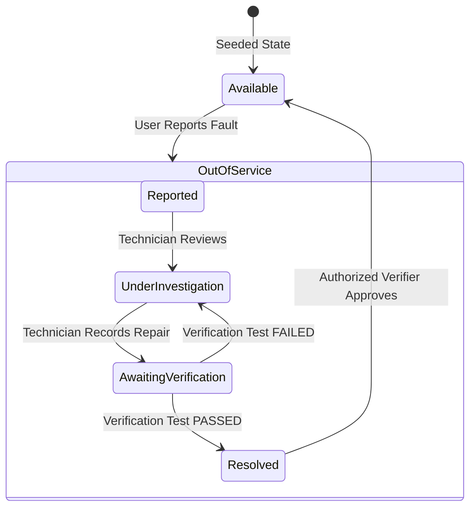

# FaultBeforeYou — Gemma 4-Powered Equipment Fault Management

> **Tagline:** Report once. Warn everyone. Verify recovery.

[](LICENSE)
[](https://nodejs.org/)
[](https://aistudio.google.com/)
[](https://www.npmjs.com/package/@google/genai)
[](#testing)

FaultBeforeYou is a full-stack, enterprise-grade equipment safety and recovery verification system. It prevents students, lab researchers, and staff from walking into shared facilities only to discover equipment that someone else has already found broken.

---

## 1. Core Mission & Guarantees

Shared equipment in schools, universities, hospitals, and offices (such as high-volume printers, classroom 4K ceiling projectors, CAD workstations, and document scanners) frequently suffer unresolved faults.

FaultBeforeYou enforces a strict three-phase cycle:
1. **Report Once:** Any user can report a fault in seconds, optionally aided by **Gemma 4 Fault Intelligence**.
2. **Warn Everyone:** The second a fault is submitted, the equipment is immediately placed **Out of Service** across the campus dashboard, preventing duplicate disruptions.
3. **Verify Recovery:** **Gemma 4 or technicians NEVER mark equipment available on their own.** Equipment can ONLY return to service after an authorized verifier logs a successful physical recovery test.

---

## 2. Technology Stack

- **Frontend:** HTML5, CSS3 (Dark Navy/Electric Cyan design system), Vanilla JavaScript (ES modules, zero heavyweight frontend frameworks).
- **Backend:** Node.js with Express (ES modules `type: "module"`).
- **Database:** SQLite with built-in `node:sqlite` (zero native compilation friction, WAL mode, foreign keys, parameterized queries).
- **AI Integration:** **Gemma 4** (`gemma-4-26b-a4b-it`) accessed through Google AI Studio using the official `@google/genai` JavaScript SDK.
- **Security:** Bcrypt password hashing, HMAC-SHA256 bearer tokens, server-side role-based access control (RBAC), and credential redaction.

---

## 3. Gemma 4 Features

### Feature A — Fault Intelligence (`backend/services/gemmaService.js`)
When a user describes an issue, Gemma 4 parses symptoms into structured JSON:
- `category`: Hardware | Supplies | Connectivity | Software | Display | Other
- `suggestedSeverity`: Low | Medium | High
- `recommendedNextStep`: Immediate safe user instructions
- `technicianRequired`: Boolean check for hazardous internal work
- `reasoningSummary`: Factual reasoning based on fault syntax

### Feature B — Approved-Manual Grounded Troubleshooting
- SQLite knowledge base storing manufacturer manuals (Lexmark Enterprise M553, Epson PowerLite Pro, Dell OptiPlex, Fujitsu fi-8170).
- Tokenized retrieval extracts relevant manual sections.
- Gemma 4 is strictly instructed to explain **ONLY** steps supported by retrieved passages, cite section numbers, and flag hazards (fuser heat, high-voltage lamp).
- **Guardrail:** If no relevant passage exists, Gemma returns: *"No verified troubleshooting guidance was found in the available manual."*

### Feature C — Incident Intelligence & Pattern Analytics
- Analyzes historical incidents and recorded verifications on the Equipment Details page.
- Identifies common faults, previous repairs, and verified successful fixes.
- Distinguishes recorded database facts from AI interpretation.
- Honors minimum incident history thresholds.

### Technician Note Structuring
- Structures raw field scribble into clean steps without adding unreported events.

---

## 4. Verified Recovery State Machine



---

## 5. Quick Start & Local Setup

### Prerequisites
- Node.js v20+ or v22+ (v22 recommended with `--experimental-sqlite`)
- Google AI Studio API Key (optional for manual/fallback testing, required for live Gemma 4 inference)

### 1. Clone & Install
```bash
git clone https://github.com/your-org/Faultbeforeyou.git
cd Faultbeforeyou
npm install
```

### 2. Configure Environment
Copy `.env.example` to `.env`:
```bash
cp .env.example .env
```

Edit `.env`:
```env
# Google AI Studio API Key (get from https://aistudio.google.com/)
GEMINI_API_KEY=your_api_key_here

# Gemma 4 Model Selection
GEMMA_MODEL=gemma-4-26b-a4b-it

# Server Port & Allowed Origins
PORT=3000
FRONTEND_ORIGIN=http://localhost:5500
```

> **Note on API Keys:** The server safely checks for `GEMINI_API_KEY`. If not set or invalid, FaultBeforeYou automatically runs in manual/deterministic fallback mode. Equipment management, reporting, repair logging, and recovery verification continue uninterrupted!

### 3. Seed Database
Initialize SQLite tables, demo users, equipment, manuals, and historical records:
```bash
npm run seed
```

### 4. Run Test Suite
```bash
npm test
```
Runs both:
- `npm run test:workflow`: 10/10 workflow, persistence, role authorization, verification pass/fail tests.
- `npm run test:gemma`: 7/7 schema compliance, grounding guardrail, and API integration tests.

### 5. Start the Server
```bash
npm start
```
Open your browser to:
👉 **`http://localhost:3000`**

---

## 6. Demo Accounts & Personas

Switch between personas at any time using the top-right header dropdown:

| Username | Password | Role | Description |
| :--- | :--- | :--- | :--- |
| `reporter` | `reporter123` | `reporter` | General user: submits faults |
| `tech` | `tech123` | `technician` | Technician: logs repairs, structures notes |
| `admin` | `admin123` | `admin` | Authorized Verifier: submits recovery test verification |
| `viewer` | `viewer123` | `viewer` | Read-only user: views warnings and manuals |

---

## 7. REST API Documentation

### Equipment Endpoints
- `GET /api/equipment` — List all equipment with filter parameters (`search`, `status`, `type`, `location`).
- `GET /api/equipment/metrics` — Aggregate summary counts for dashboard cards.
- `GET /api/equipment/:id` — Equipment details, active incident alert, latest verification.
- `GET /api/equipment/:id/history` — Full history of incidents, verifications, and status changes.
- `GET /api/equipment/:id/ai-summary` — Gemma Feature C historical incident intelligence.

### Incident Endpoints
- `GET /api/incidents` — List all incidents (`status`, `equipmentId`).
- `GET /api/incidents/:id` — Full incident record with timeline and verification records.
- `POST /api/incidents` — Report fault. Sets equipment to `out_of_service`. *(Requires role: `reporter`, `technician`, `admin`)*.
- `POST /api/incidents/:id/update` — Record technician repair attempt. *(Requires role: `technician`, `admin`)*.
- `POST /api/incidents/:id/ai-structure-notes` — Structures raw technician notes using Gemma 4.

### Recovery Verification Endpoints
- `POST /api/verification` — Submit test verification result (`passed` or `failed`). *(Strictly requires role: `admin` / Authorized Verifier)*.
  - If `passed`: Marks incident `resolved`, restores equipment to `available`.
  - If `failed`: Incident remains `under_investigation`, equipment remains `out_of_service`.
- `GET /api/verification/history` — Historical verification tests log.

### Troubleshooting & AI Endpoints
- `GET /api/troubleshoot/manuals` — List approved demonstration manuals.
- `POST /api/troubleshoot/query` — Gemma Feature B approved-manual grounded troubleshooting.
- `GET /api/ai/status` — Returns Gemma 4 status, configured model, and API health.
- `POST /api/ai/classify` — Direct fault classification preview.
- `GET /api/notifications` — Real-time warning alert stream.

---

## 8. Deployment Guide

### Option A: Unified Full-Stack Deployment (Recommended)
Because Express serves the frontend from `frontend/`, deploy the entire repository to any Node.js hosting platform (Render, Railway, Fly.io, Heroku, AWS ECS):
1. Set environment variables: `GEMINI_API_KEY`, `GEMMA_MODEL=gemma-4-26b-a4b-it`, `PORT=3000`.
2. Build / Start command: `node --experimental-sqlite backend/server.js`.
3. Provide persistent volume for `data/faultbeforeyou.db`.

### Option B: Split Static Frontend + Backend Host
- **Frontend:** Host `frontend/` on Netlify, Vercel, Cloudflare Pages, or AWS S3 + CloudFront over HTTPS.
- **Backend:** Host `backend/` on a Node.js server.
- Configure `FRONTEND_ORIGIN=https://your-frontend-domain.com` in `.env` to enable secure CORS.
- Set `API_BASE` in `frontend/js/api.js` to point to the backend HTTPS URL.

---

## 9. Live Demo Script
For an exact 12-step walkthrough during judging, refer to:
👉 [DEMO.md](file:///Users/shivangismac/Downloads/project/Faultbeforeyou/DEMO.md)
